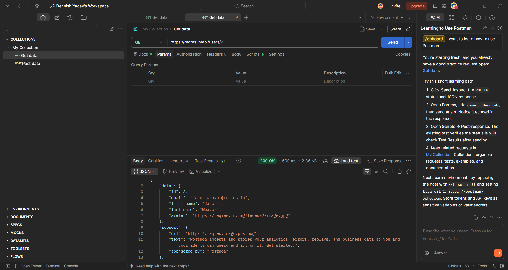
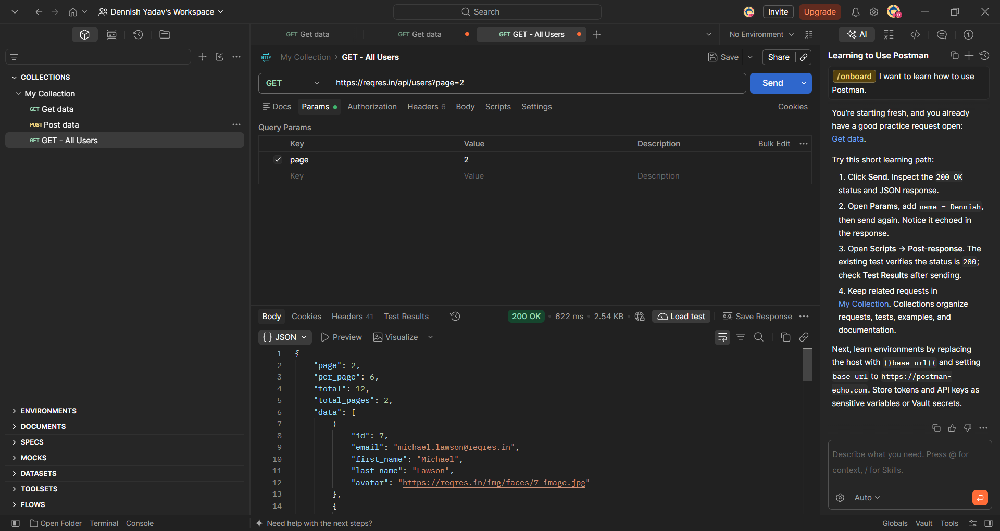
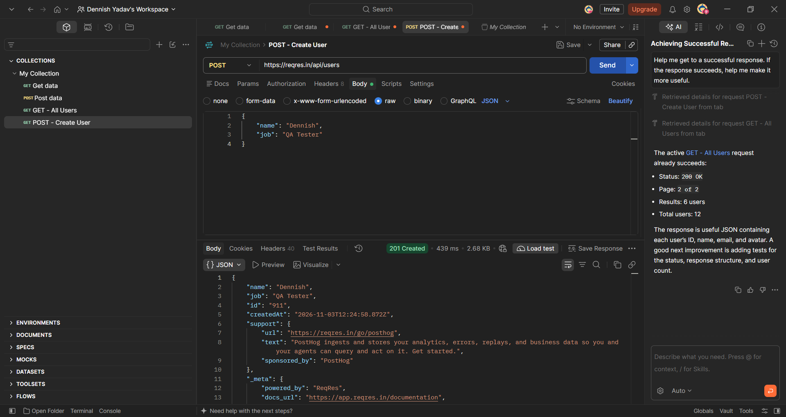
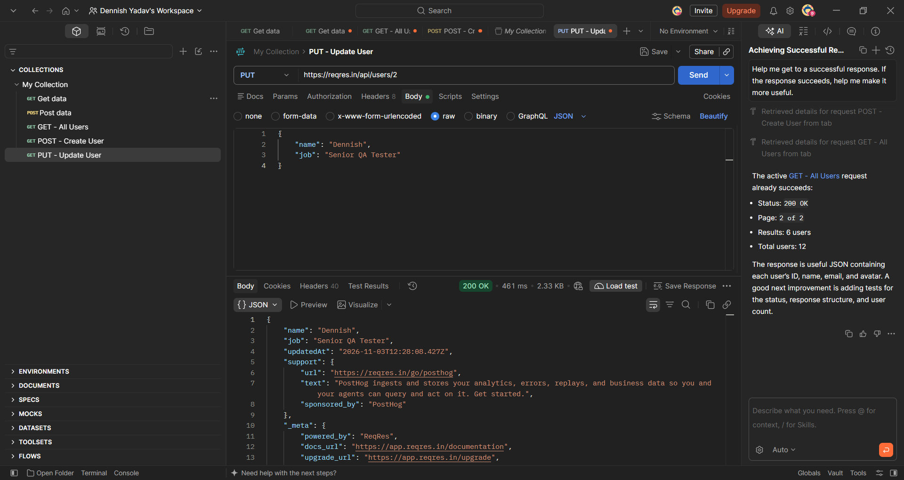
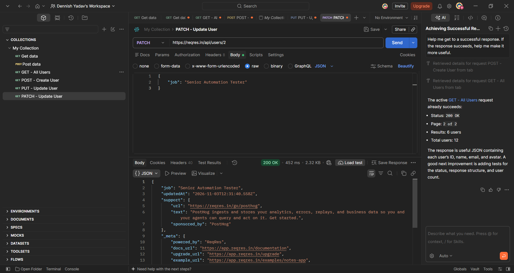
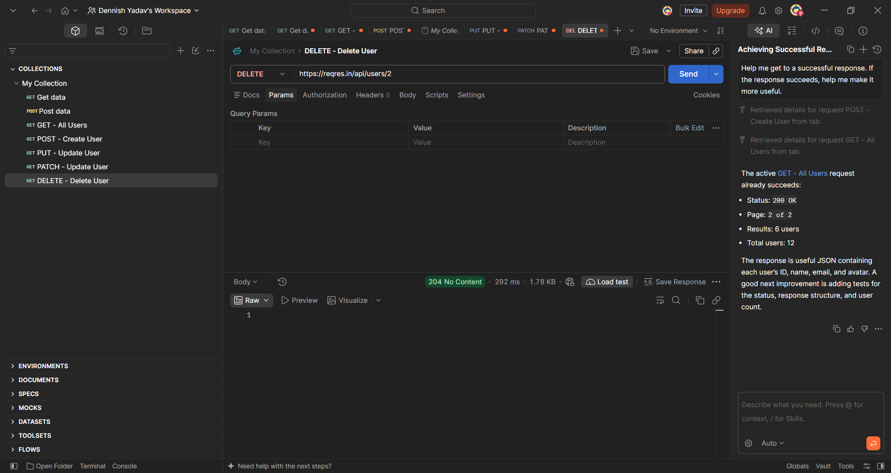
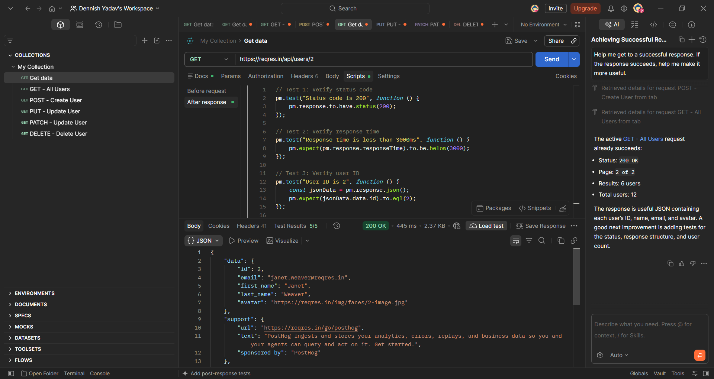
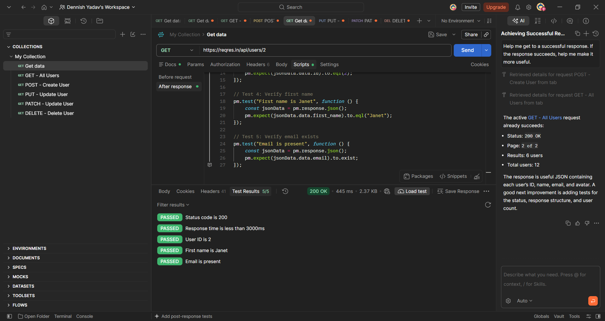

# 🚀 Reqres API Testing Project | Postman


## 📌 Project Overview

This project demonstrates **REST API testing using Postman** with the Reqres sample API.

The project covers different HTTP methods, response status codes, response times, JSON response validation, and automated test scripts.

The objective is to gain practical experience in API testing and demonstrate fundamental software testing skills.

## 🎯 Project Objectives

* Understand REST API concepts.
* Test APIs using different HTTP methods.
* Validate HTTP response status codes.
* Verify JSON response data.
* Validate API response times.
* Write automated test scripts using JavaScript in Postman.
* Understand CRUD operations.
* Document API testing results with screenshots.

## 🛠️ Tools & Technologies

| Tool       | Purpose                             |
| ---------- | ----------------------------------- |
| Postman    | API testing and automation          |
| Reqres API | Sample REST API                     |
| JavaScript | Writing API test scripts            |
| JSON       | Request and response data           |
| GitHub     | Project documentation and portfolio |

## 🌐 API Information

**Base URL:** `https://reqres.in/api`

### API Endpoints Tested

| HTTP Method | Endpoint        | Description                  |
| ----------- | --------------- | ---------------------------- |
| GET         | `/users/2`      | Retrieve a single user       |
| GET         | `/users?page=2` | Retrieve all users on page 2 |
| POST        | `/users`        | Create a new user            |
| PUT         | `/users/2`      | Update an existing user      |
| PATCH       | `/users/2`      | Partially update a user      |
| DELETE      | `/users/2`      | Delete a user                |

## 🧪 API Testing Details

### 1️⃣ GET – Retrieve Single User

* Verified HTTP status code: `200 OK`.
* Validated response time.
* Verified user ID.
* Verified first name.
* Verified email presence.

**Test Results: 5/5 Passed ✅**

### 2️⃣ POST – Create User

* Verified HTTP status code: `201 Created`.
* Validated response time.
* Verified user name.
* Verified job information.
* Verified generated user ID.
* Verified created date.

**Test Results: 6/6 Passed ✅**

### 3️⃣ PUT – Update User

* Verified HTTP status code: `200 OK`.
* Validated response time.
* Verified updated user name.
* Verified updated job information.

**Test Results: 4/4 Passed ✅**

### 4️⃣ PATCH – Partially Update User

* Verified HTTP status code: `200 OK`.
* Validated response time.
* Verified updated job information.
* Verified updated date.

**Test Results: 4/4 Passed ✅**

### 5️⃣ DELETE – Delete User

* Verified HTTP status code: `204 No Content`.
* Validated response time.

**Test Results: 2/2 Passed ✅**

### 6️⃣ GET – Retrieve All Users

* Executed GET request to retrieve users.
* Verified successful response: `200 OK`.
* Observed page 2 containing 6 users.
* API response indicated 12 users in total.

## 📊 Automated Test Execution Summary

| API Request                    |     Test Results |
| ------------------------------ | ---------------: |
| GET – Single User              |       5/5 Passed |
| POST – Create User             |       6/6 Passed |
| PUT – Update User              |       4/4 Passed |
| PATCH – Update User            |       4/4 Passed |
| DELETE – Delete User           |       2/2 Passed |
| **Total Automated Assertions** | **21/21 Passed** |

**Overall Result: 21/21 automated assertions passed ✅**

*Note: The 21 assertions represent the five requests with visible Postman test results. GET – All Users was also executed successfully, but its assertion count is not included in this total.*

## 📸 Screenshots & Test Evidence

The following screenshots provide visual evidence of the API requests, responses, and automated test execution.

### 1. GET – Retrieve Single User



### 2. GET – Retrieve All Users



### 3. POST – Create User



### 4. PUT – Update User



### 5. PATCH – Partially Update User



### 6. DELETE – Delete User



### 7. GET API – Automated Test Results



### 8. Additional API – Automated Test Results



## 📂 Project Structure

```text
REST-API-Testing-Postman/
│
├── Screenshots/
│   ├── 01-GET-Single-User.png
│   ├── 02-GET-All-Users.png
│   ├── 03-POST-Create-User.png
│   ├── 04-PUT-Update-User.png
│   ├── 05-PATCH-Update-User.png
│   ├── 06-DELETE-Delete-User.png
│   ├── 07-GET-API-Automated-Tests.png
│   └── 08-GET-API-Automated-Tests.png
│
├── Reqres-API-Testing.postman_collection.json
│
└── README.md
```

## 💡 Key Learnings

Through this project, I gained practical experience in:

* Understanding REST API architecture.
* Working with GET, POST, PUT, PATCH, and DELETE methods.
* Sending API requests through Postman.
* Validating HTTP status codes.
* Writing JavaScript-based automated test scripts.
* Verifying JSON response attributes.
* Checking API response times.
* Organizing API requests into Postman collections.
* Documenting API testing activities and results.

## 🔮 Future Enhancements

* Add negative test scenarios.
* Perform API testing with different test data.
* Add JSON schema validation.
* Explore Postman Collection Runner.
* Integrate API tests with Newman.
* Explore CI/CD pipeline integration.

## 👨‍💻 Author

**Dennish Yadav**

MCA Graduate | Aspiring Software Tester | API Testing Enthusiast

**Skills:** Manual Testing | API Testing | Postman | REST API | SQL | JavaScript Basics

---

⭐ **Thank you for visiting my project!**
